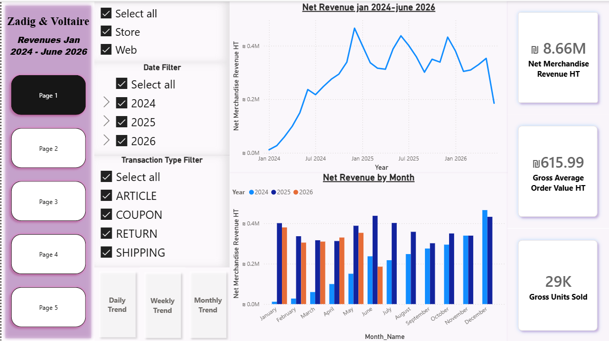
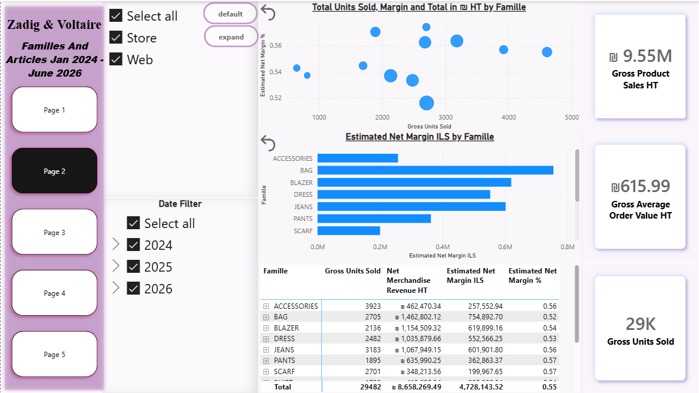
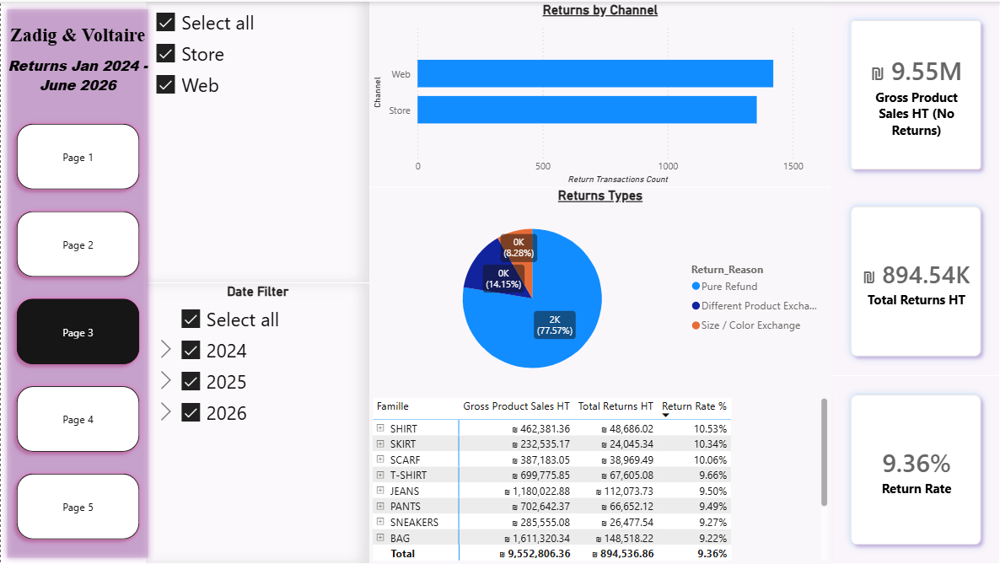
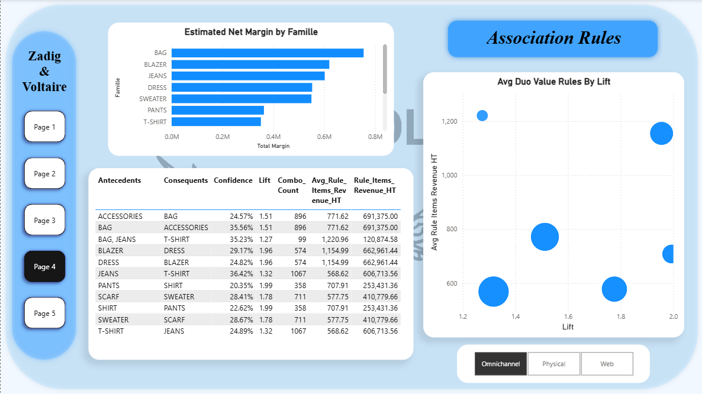
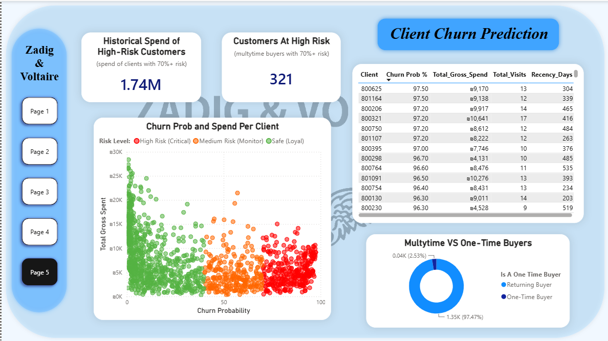

# Synthetic Fashion Retail Analytics | Python, Machine Learning & Power BI

An end-to-end analytics case study exploring **sales, product performance, returns, cross-selling and customer retention**. A simulated point-of-sale dataset flows through Python data cleaning, DuckDB, XGBoost, FP-Growth and a five-page Power BI report.

> **Synthetic-data disclosure:** All transactions, customers, products and results are fictional. The dashboard retains Zadig & Voltaire branding for presentation only; the results do **not** describe that company's operations. Purchasing behavior and category affinities are deliberately simulated.

| Period | Transaction lines | Net revenue HT | Estimated net margin | Returning customers scored | Association rules |
|---|---:|---:|---:|---:|---:|
| Jan 2024 – Jun 16, 2026 | 34,622 | ₪8.66M | ₪4.73M | 1,347 | 34 |

**Jump to:** [Business questions](#business-questions) · [Findings](#analysis-findings-and-interpretation) · [Conclusions](#overall-conclusions) · [Recommendations](#key-business-recommendations--next-steps) · [Dashboards](#power-bi-dashboard) · [Run the pipeline](#reproduction-on-windows--powershell)

## Business context and objectives

A retailer needs more than sales totals to assess performance. This project asks how returns affect revenue, whether best-selling categories are also the most profitable, which items appear together in baskets, and how purchase history can support retention analysis. The aim is to connect **business questions → evidence → interpretation → possible decisions**, while making the entire process reproducible.

**Terminology:** All amounts are in ILS. **HT** = excluding VAT; **TTC** = including VAT. Estimated margin uses synthetic purchase-cost assumptions, not audited costs.

## Business questions

| Area | Question |
|---|---|
| **Sales** | Which factors drive changes in net merchandise revenue across time and sales channels? |
| **Products** | Which product categories contribute the most to the business, and how do their rankings change when performance is measured by volume, revenue, and estimated margin? |
| **Returns** | Which product categories have the greatest return-related financial impact, and does prioritization change when considering return rates rather than absolute return values? |
| **Market basket** | Which product-category combinations show the strongest co-purchase associations, and how could these patterns inform cross-selling hypotheses? |
| **Retention** | How can historical purchases segment eligible returning customers by illustrative churn risk? |

## Data and analytical approach

| Stage | What the project does | Why it matters |
|---|---|---|
| **Generate & clean** | Simulate invoices, returns and products; validate dates, keys, quantities and VAT. | Establish reliable transaction-level inputs. |
| **Model & reconcile** | Check category totals and build a five-table DuckDB star schema. | Support consistent KPIs and filters. |
| **Analyze retail KPIs** | Compare sales, returns, units and estimated margin. | Distinguish revenue from contribution and return impact. |
| **Discover basket rules** | Run FP-Growth for Omnichannel, Physical and Web. | Quantify co-purchase patterns with confidence and lift. |
| **Score & visualize** | Train XGBoost on historical returning-customer features; export seven CSVs to Power BI. | Explore risk segments alongside interactive retail dashboards. |

## Analysis, findings and interpretation

The comparisons below come from the **seeded fictional dataset** (1,400 simulated customer candidates, seed 42). They describe this simulation, not real retail performance.

### 1. Sales performance — growth, fluctuations and channels

**Question:** How does net merchandise revenue vary across time and sales channels, and what patterns could inform retail planning?

**Finding:** Net merchandise revenue reached **₪8.66M**, after **₪894.54K** in returns. Monthly sales grew strongly during 2024, then followed a more stable but fluctuating pattern through 2025 and early 2026. The trend is roughly **W-shaped**, with peaks around **December–January and June–July**. Web contributed **51.9%** of net revenue versus **48.1%** from physical stores, with a slightly lower value-based return rate (**9.18% vs. 9.56%**).

**Conclusion:** After the initial growth period, revenue showed recurring seasonal-looking peaks that could inform further inventory planning. Channel contributions and returns also influence net revenue; the chart shows associations over time, **not proven causes or established seasonality**. June 2026 is a partial month.

### 2. Product performance — how rankings change by metric

**Question:** Which product categories contribute the most to the business, and how do their rankings change when performance is measured by volume, revenue, and estimated margin?

**Finding:** **T-SHIRT** led gross units sold (**4,609**), while **BAG** led net merchandise revenue (about **₪1.46M**) and total estimated net margin (**₪754.9K**). **SCARF** had the highest estimated margin rate (about **57.4%**). Despite selling fewer units than T-SHIRT, BAG generated more than twice its estimated net margin (about **₪754.9K vs. ₪350.9K**).

**Conclusion:** Volume, revenue and profitability identify **different category leaders**. BAG contributes most in total estimated margin, while high-volume T-SHIRT and high-margin-rate SCARF illustrate why merchandising priorities should not be based on unit sales alone. These margins depend on simulated cost assumptions.

### 3. Returns — rates versus financial impact

**Question:** Which product categories have the greatest return-related financial impact, and does prioritization change when considering return rates rather than absolute return values?

**Finding:** **BAG** had the highest absolute return value (**₪148.5K**) at a **9.22%** return rate. **SHIRT** had the highest return rate (**10.53%**, versus **9.36%** overall) but a much smaller return value (**₪48.7K**).

**Conclusion:** Priorities **change with the metric**: BAG stands out for total financial exposure, while SHIRT stands out for its relative return rate. Both merit investigation for different reasons. The dashboard's refund/exchange classifications are inferred from invoices, **not verified customer-reported reasons**.

### 4. Market basket — strongest co-purchase associations

**Question:** Which product-category combinations show the strongest co-purchase associations, and how could these patterns inform cross-selling hypotheses?

**Finding:** FP-Growth generated **34 directional rules** across three channel populations. In Omnichannel baskets, **PANTS → SHIRT** showed approximately **20.35% confidence and 1.99 lift**—one of the strongest relative associations—while **JEANS → T-SHIRT** had higher confidence (**36.42%**) but lower lift (**1.32**).

**Conclusion:** The most frequent conditional pairing is not necessarily the strongest relative association. These rules can motivate cross-selling tests, but do **not** establish causal effects or incremental revenue. Category affinities were deliberately simulated; Omnichannel includes both Web and Physical baskets.

### 5. Customer retention — which returning customers receive higher risk scores?

**Question:** Can purchase history help describe differences in predicted inactivity among returning customers?

**Finding:** XGBoost scored **1,347 eligible returning customers** using features such as recency, frequency and spend. **321 (23.8%)** fall in the provisional **70%+** risk tier with **₪1.74M** in historical spending.

**Conclusion:** The scores demonstrate a possible segmentation workflow, **not** a validated retention policy. The score bands are exploratory; out-of-time generalization, probability calibration and real intervention impact have not been established. The simulated population also contains an unusually high share of returning buyers.

## Overall conclusions

The simulated results show why **a single sales KPI is insufficient**: merchandise returns reduced gross sales of about **₪9.55M** to **₪8.66M** net; **T-SHIRT leads in units while BAG leads in net revenue and estimated margin**; and **BAG's return value is highest even though SHIRT has the higher return rate**. Basket associations and churn scores provide testable hypotheses rather than proven interventions. These are findings from fictional transactions, not a retailer's actual performance.

## Key Business Recommendations & Next Steps

1. **Reduce return-related losses:** Investigate BAG's high return value (**₪148.5K**) and SHIRT's above-average return rate (**10.53%**). Review product-level transactions and verified return reasons, test targeted improvements, and track changes in returns and costs.
2. **Test cross-selling recommendations:** Use association rules to show **related products together on website product pages** and **suggest an associated item when a shopper adds a product to their cart** (e.g., JEANS → T-SHIRT). Also test complementary displays in selected stores. Compare joint-purchase rates and incremental margin with control groups.
3. **Pilot targeted retention outreach:** **After validating the churn model**, test personalized emails or discount coupons with a subset of the **321 provisionally high-risk customers**. Compare repeat purchases, incremental margin and promotion costs against a control group.

*These are proposals based on simulated findings; effectiveness and applicability require validation with real business data and controlled testing.*

## Power BI dashboard

The five-page Power BI report visualizes the analyses above using the **same synthetic dataset**. The screenshots show one saved view per page; the PBIX supports interactive filtering and bookmarks when opened in Power BI Desktop.

> **Brand and publication note:** The visible Zadig & Voltaire branding does not imply affiliation, endorsement or the use of company records. Ensure you have permission or another appropriate basis to publish third-party brand assets. The PBIX should be independently reviewed for embedded data and metadata before public release.

### Page 1 — Sales Overview

Revenue trends, net merchandise revenue, gross average order value and gross units sold with channel/date filters. See [Analysis 1](#1-sales-performance--growth-fluctuations-and-channels).



### Page 2 — Product Performance

Sales volume, gross product sales, estimated net margin by family and margin-versus-volume comparison. See [Analysis 2](#2-product-performance--how-rankings-change-by-metric).



### Page 3 — Returns Analysis

Return values, channel breakdown, category rates and inferred refund/exchange classifications. See [Analysis 3](#3-returns--rates-versus-financial-impact).



### Page 4 — Retail Strategy & Association Rules

Estimated margin by product family and FP-Growth association metrics, with Omnichannel, Physical and Web selections. See [Analysis 4](#4-market-basket--strongest-co-purchase-associations).



### Page 5 — Customer Retention

Illustrative returning-customer churn scores, customer spend, tier counts and purchase-frequency segmentation. See [Analysis 5](#5-customer-retention--which-returning-customers-receive-higher-risk-scores).




## Architecture and file roles

| Program | Reads | Writes or checks |
|---|---|---|
| `generate_raw_fastmag.py` | Invented in-code simulator parameters via `generate_synthetic_retail.py` | `fastmag (2).xls` and `fastmag_familles_total.xls` (both **tab-delimited text**, not binary Excel workbooks) |
| `generate_synthetic_retail.py` | No external data | Shared simulation functions; *optional* standalone preview mode |
| `main.py` | `fastmag (2).xls` | `fastmag_staged_v2.csv` |
| `comparaison_familles.py` | Staged CSV + synthetic category totals | TTC and quantity reconciliation to console; fails on differences |
| `sales_by_famille.py` | Staged CSV | Signed net-revenue and estimated-margin reconciliation; optional daily CSV |
| `DuckDB.py` | Staged CSV | `fastmag_retail_v2.db` with five star-schema tables |
| `Data_to_powerbi.py` | DuckDB database | Five `powerbi_tables_v2/*.csv` exports |
| `Churn_Prep.py` | Staged CSV | Historical 365-day churn feature and label CSV |
| `Churn_Model.py` | Feature CSV + staged CSV | Current synthetic returning-customer churn scoring CSV |
| `MarketBasket_to_bi.py` | Staged CSV | FP-Growth rules in `powerbi_tables_v2/market_basket_rules_v2.csv` |

## Reproduction on Windows / PowerShell

Requires Python **3.10+**. Open PowerShell **in the folder containing these ten scripts**. Create an isolated Python environment if desired:

```powershell
python -m pip install -r requirements.txt

# Create the two raw synthetic inputs. Use an EMPTY output folder.
python .\generate_raw_fastmag.py --output-dir .\synthetic_raw --customers 1400 --seed 42

# Run downstream programs from synthetic_raw so all relative paths stay isolated.
cd .\synthetic_raw
python ..\main.py
python ..\comparaison_familles.py
python ..\sales_by_famille.py
python ..\DuckDB.py
python ..\Data_to_powerbi.py
python ..\Churn_Prep.py
python ..\Churn_Model.py
python ..\MarketBasket_to_bi.py
```

A regenerated raw export will **not overwrite** an existing `synthetic_raw/fastmag (2).xls` or reference report. For a new run, choose another empty output directory or archive the generated directory first. Keep private datasets and other non-synthetic files outside the project.

## Expected demonstration properties

With 1,400 customers and seed 42, the raw generator uses a reporting boundary of **2024-01-01 to 2026-06-16**. Purchases are probabilistic, so the first recorded transaction may fall later than the calendar start. `DuckDB.py` explicitly creates the full 898-day reporting calendar.

- Transaction grain is `(Vente, Ligne)`; negative merchandise quantities represent returns.
- The category-control report is computed from the **same** synthetic records. It demonstrates reconciliation, not independent financial verification.
- `PrixAchat_ILS` assumes an approximate fixed factor of 4.0. Merchandise margin is an **estimate**, not audited profit.
- Churn eligibility requires at least two qualifying purchase invoices before the relevant cutoff. Training labels refer to the following 365 days; the model's high/medium/low bands are descriptive, not calibrated or actionable probabilities.
- Basket mining uses positive sale merchandise lines. Omnichannel contains both Physical and Web baskets; the same basket can support multiple rules. Rule revenue must not be summed across rules or overlapping channels.
- The synthetic generator intentionally induces preferences and category affinities; discovered associations are valid statistics on *invented behavior*, not findings about a real retailer.


## Power BI and publication precautions

Power BI uses seven generated synthetic CSVs (five DuckDB exports, churn scores and basket rules). The locally maintained report is placed in `powerbi/`, while screenshots are in `dashboard_images/`. The supplied `.gitignore` permits `.pbix` files located directly in `powerbi/` while ignoring `.pbix` files elsewhere and all `.pbit` files. This exception permits tracking; it is **not** a security or publication-rights audit. Check the final report before committing it.

If a report was developed from an older PBIX, changing its source paths alone does not prove that it is free of embedded private rows, cached filter selections, stored metadata or other disclosure risks. Verify the final report and images independently before publication. Also confirm that you have an appropriate basis to publish any brand marks visible in the report and screenshots.

This repository demonstrates fictional analytics. Do not describe synthetic model scores or simulated financial patterns as real-world results. Review source-code ownership and publication permission separately from the absence of customer data.
